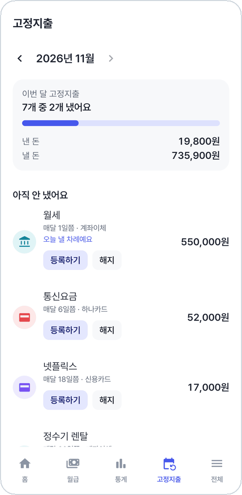
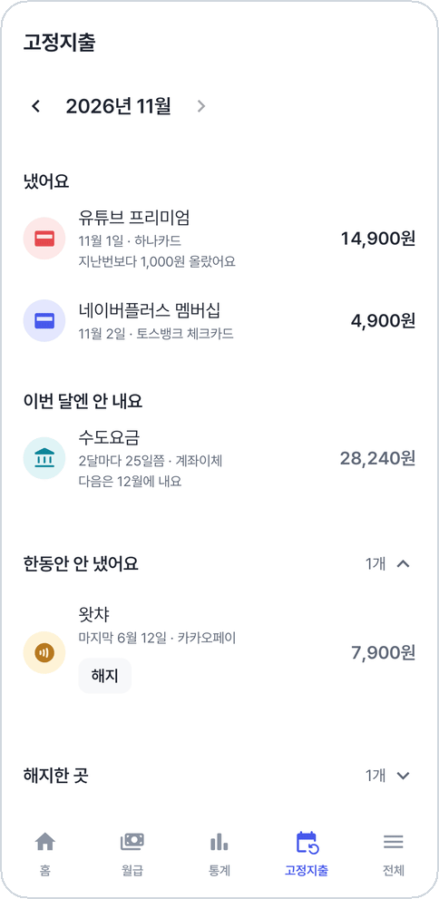
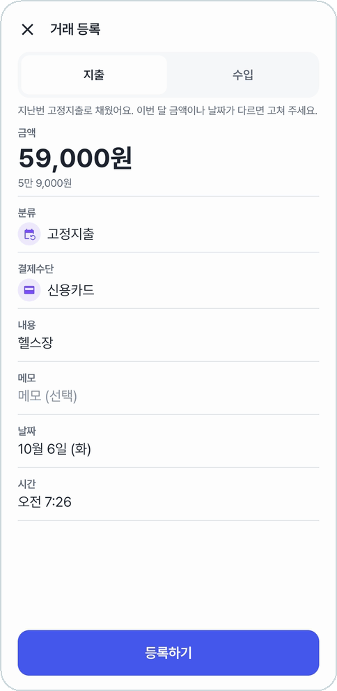
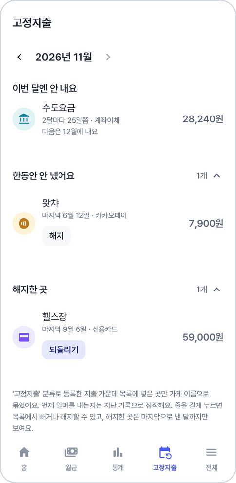

# 고정지출

월세·통신요금·구독료처럼 매달 나가는 돈을 **이번 달에 냈는지** 한눈에 본다.
'고정지출' 분류로 등록한 지출 가운데 **고정지출 목록에 넣은 곳**만 가게 이름별로 모으고, 언제 얼마를 내는지는 지난 기록으로 짐작한다.
날짜와 금액은 따로 정해 둘 것이 없다.
적금·청약처럼 매달 넣는 돈은 [저축](savings.md#고정저축)의 **고정저축**에서 같은 방식으로 본다.

<table>
<tr>
<td align="center" width="33%">
 
<b>몇 개 냈는지, 낸 돈과 낼 돈</b>
</td>
<td align="center" width="33%">
 
<b>냈어요 · 이번 달엔 안 내요 · 한동안 안 냈어요</b>
</td>
<td align="center" width="33%">
 
<b>'등록하기'는 지난번 값으로 채운 등록창</b>
</td>
</tr>
</table>

## 묶음

| 묶음 | 뜻 |
|---|---|
| 아직 안 냈어요 | 이번 달 낼 차례인데 아직 기록이 없다. 줄마다 **등록하기** · **해지** 버튼 |
| 냈어요 | 이번 달 몫을 냈다 |
| 이번 달엔 안 내요 | 2달마다·매년 내는 것 중 이번 달은 차례가 아닌 것 |
| 한동안 안 냈어요 | 몇 달째 기록이 없는 것(끊겼거나 그만둔 것). 접혀 있고, 줄마다 **해지** 버튼이 있다 |
| 해지한 곳 | **해지**를 누른 곳. 접혀 있고, 줄마다 **되돌리기** 버튼이 있다 |
| 등록 안 한 곳 | 묻는 것에 **안 함**을 눌렀거나 목록에서 뺀 곳. 접혀 있고, 줄마다 **등록** 버튼이 있다 |

맨 위에는 '7개 중 3개 냈어요'와 낸 돈·낼 돈을 막대로 보여 준다. 목록에 넣은 곳(해지한 곳은 마지막으로 낸 달까지)만 센다. **‹** 로 지난 달도 본다.

## 고정지출 목록

'고정지출' **분류**와 이 탭의 **목록**은 따로다. 분류는 거래마다 그대로 두고, 탭에는 목록에 넣은 곳만 보인다.

- 목록에 없는 곳을 '고정지출' 분류로 적으면 맨 위에 **고정지출로 등록할까요?** 가 뜬다. 마지막으로 낸 날·결제수단·금액을 보고 **등록**이나 **안 함**을 누른다.
- 고정지출이 아니게 된 곳은 줄을 **길게 눌러** 목록에서 뺀다. 지난 거래는 '고정지출' 분류 그대로 남는다. 그만 낸 곳이면 같은 창의 **해지**를 누른다([해지](#해지)).
- 안 함을 눌렀거나 뺀 곳도 그 뒤에 '고정지출' 분류로 **새로 내면**(빼고 나서 다시 구독하는 등) 다시 묻는다. 빼기 전에 앞 날짜로 미리 적어 둔 거래로는 묻지 않는다.
- 잘못 뺐으면 맨 아래 **등록 안 한 곳**을 펼쳐 **등록**을 누른다.
- '고정지출' 분류 지출이 하나도 남지 않은 곳(거래를 지웠거나 다른 분류로 옮김)은 목록에서도 지워져, 다시 적으면 처음처럼 묻는다.
- 목록이 생기기 전 버전에서 업데이트하면, 그날 탭에 보이던 곳(한동안 안 냈어요까지)이 모두 목록에 들어가 있어 탭이 그대로다.
- 목록은 백업에 함께 담긴다(해지한 곳과 해지한 때도). 목록이 없는 옛 백업을 복원하면 그날 탭에 보였을 곳을 목록에 넣는다.

## 해지

내다가 그만둔 곳(끊은 구독, 이사 전 집의 월세 등)은 목록에서 빼지 않고 **해지**한다. 그동안 낸 달의 판에는 그대로 남는다.

<table>
<tr>
<td align="center" width="50%">
 
<b>한동안 안 냈어요의 해지 · 해지한 곳의 되돌리기</b>
</td>
</tr>
</table>

- **아직 안 냈어요**와 **한동안 안 냈어요** 줄에 **해지** 버튼이 있다. 다른 줄은 **길게 눌러** 뜨는 창에서 **해지**를 고른다.
- 버튼을 누르면 **'넷플릭스' 해지했나요?** 하고 한 번 더 묻는다.
- 해지하기 전에 마지막으로 낸 몫의 달까지는 판에 그대로 보이고, 다음 달부터는 안 보인다. 다음 차례 몫을 미리 냈으면(2월에 3월 몫) 그 몫의 달까지 보인다.
- 해지한 달에 남은 차례는 기다리지 않는다. 한 달에 두 번 내다 한 번만 내고 해지했으면 **2번 중 1번만 냈어요**로 냈어요에 둔다.
- 해지한 곳은 맨 아래 접힌 **해지한 곳**에 모인다. 줄에는 해지하기 전에 마지막으로 낸 날·결제수단·금액이 나온다. **되돌리기**를 누르면 다시 목록에 넣은 곳이 된다.
- 해지한 뒤에 '고정지출' 분류로 **새로 내면**(다시 가입하는 등) 맨 위에서 **고정지출로 등록할까요?** 하고 다시 묻는다. **등록**하면 해지가 풀리고, **안 함**이면 해지한 곳에 그대로 둔다. 해지하기 전에 앞 날짜로 미리 적어 둔 거래로는 묻지 않는다.
- 목록에서 **빼면** 지난 달 판에서도 사라진다. 고정지출이 아니었던 곳은 빼고, 내다가 그만둔 곳은 해지한다.

## 줄에 붙는 말

- 언제 내는지: **매달 6일쯤**, **2달마다 25일쯤**, **매년 3월 25일쯤**, 한 달에 두 번이면 **매달 3일, 28일쯤**, 자주 내는 곳은 **한 달에 13번쯤**
- **평소보다 2일 지났어요**(빨강): 낼 날이 지났는데 기록이 없다
- **오늘 낼 차례예요**
- **9월 차례도 안 냈어요**: 지난 차례를 놓쳤다
- **지난번보다 1,000원 올랐어요 / 내렸어요**
- **다음은 11월에 내요**
- **3월 몫을 2월 22일에 미리 냈어요**
- **2번 중 1번 냈어요**: 한 달 몫을 나눠 내거나, 두 회선 중 하나만 나갔다

평소 날짜가 **주말이나 공휴일**이면 다음 영업일을 낼 날로 본다(공휴일 달력이 들어 있다).
그래서 연휴 때문에 밀려 나가는 것을 '지났어요'로 잘못 알리지 않는다.

## 등록하기

**아직 안 냈어요** 줄의 **등록하기**를 누르면 지난번 금액·결제수단·가게로 채운 등록창이 열린다.
이번 달 금액이나 날짜가 다르면 고쳐서 등록한다.

줄을 누르면 그 가게의 가장 최근 거래 상세가 열리고, 거기서 최근 1년 동안 낸 내역을 본다.

## 쓰는 법

- 매달 나가는 지출을 등록할 때 분류를 **고정지출**로 고르고, 탭에서 묻는 것에 **등록**을 누른다. 몇 달 쌓이면 알아서 날짜를 짐작한다.
- 가게 이름(내용)이 같아야 하나로 묶인다. 띄어쓰기·대소문자만 다르면 같은 곳이다.
- '고정지출' 분류를 지웠다가 같은 이름으로 다시 만들면 다시 알아본다. 분류를 지울 때 '기타'로 옮겨 간 지출은 돌아오지 않아서, 그 뒤 새로 적은 곳부터 다시 묻는다.

---

[← 이전: 저축](savings.md) · [목차](../../README.md#메뉴별-안내) · [다음: 카드실적 →](card-performance.md)
